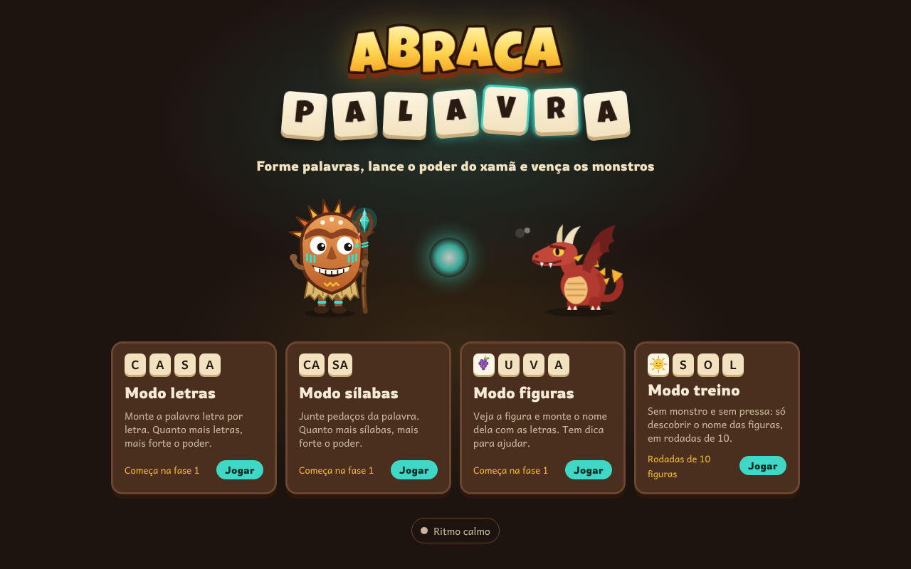
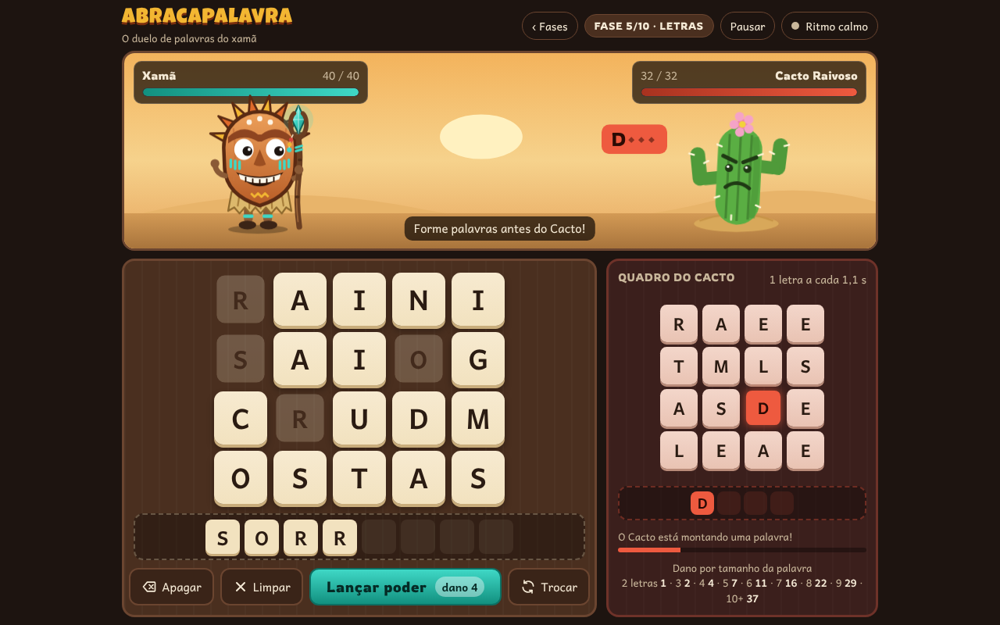
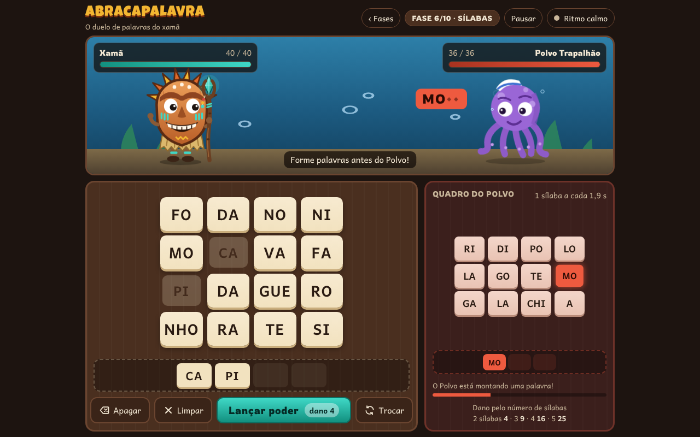
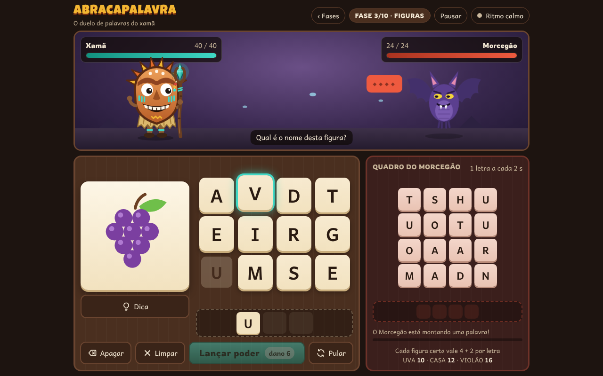
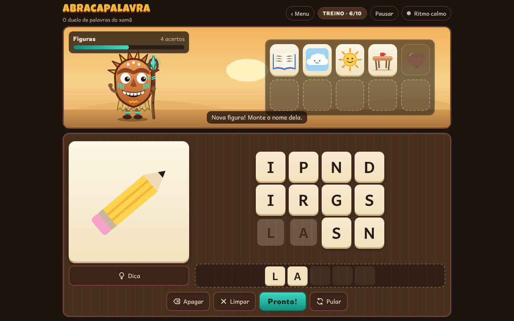
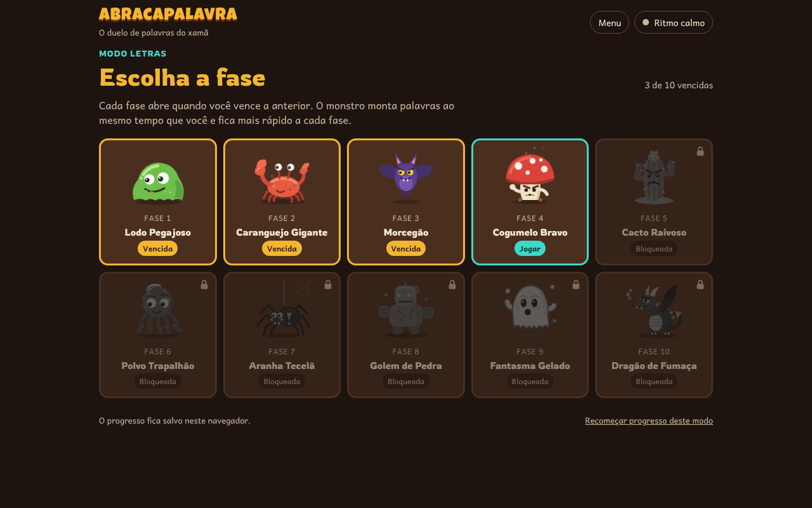
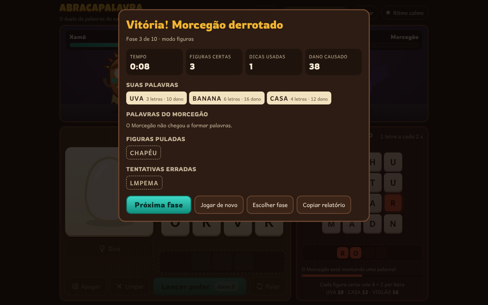
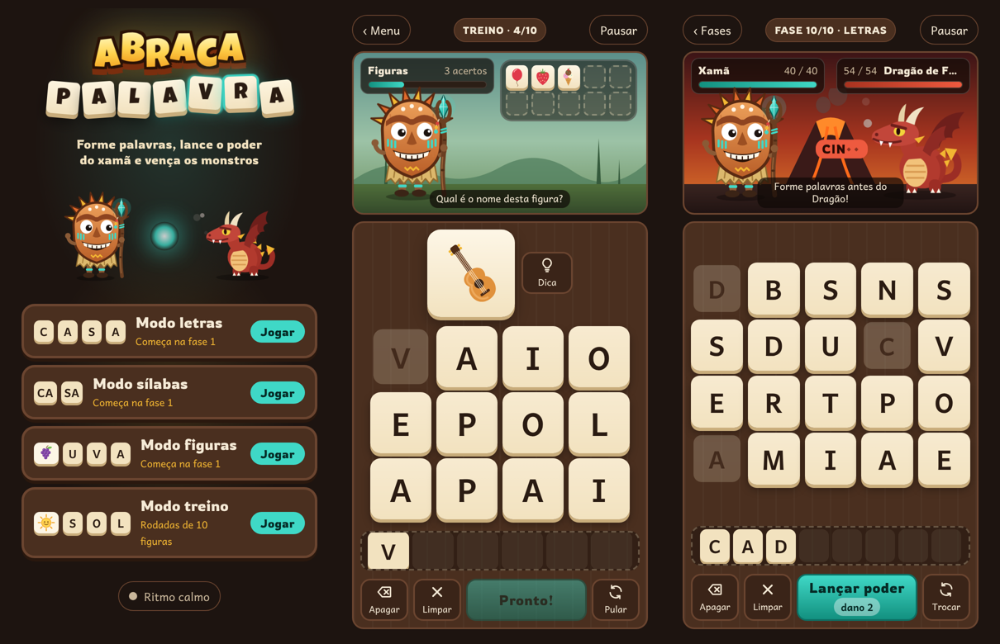
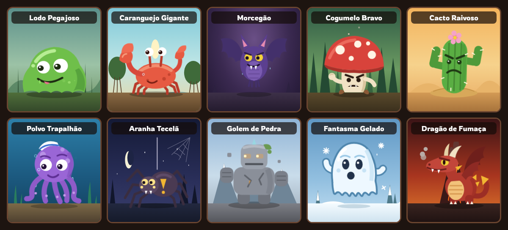
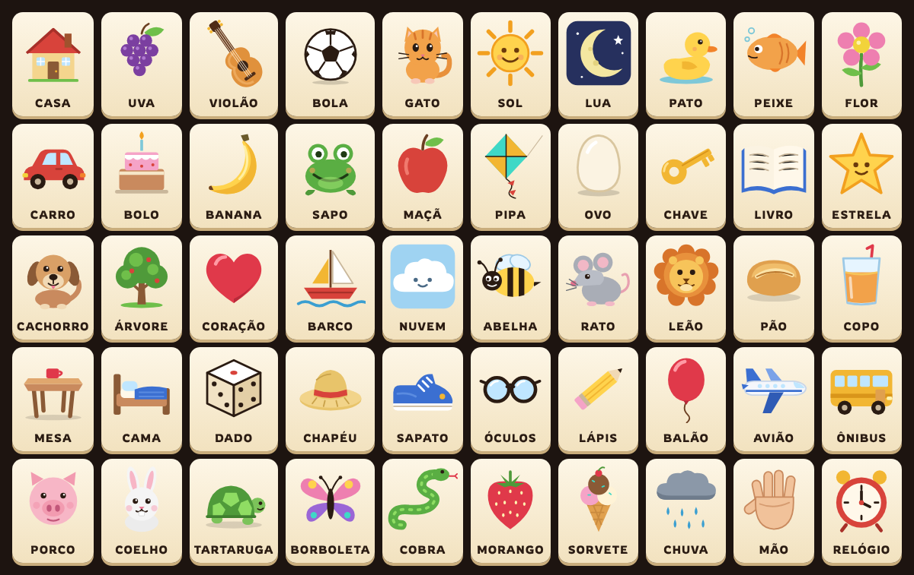

# Abracapalavra

Jogo educativo de formar palavras para as aulas de informática educativa.

O xamã enfrenta um monstro por fase. Os dois formam palavras ao mesmo tempo, cada um no seu quadro, e quem forma a palavra lança um poder no outro. Quanto maior a palavra, mais forte o poder, e a cada fase o monstro monta palavras mais rápido. Para quem está começando, o modo treino tira o monstro e deixa só a figura e as letras.



## Modos de jogo

| Modo | Como funciona |
| --- | --- |
| **Letras** | Monte palavras letra por letra. Quanto mais letras, mais dano. |
| **Sílabas** | Junte sílabas (CA + SA). O dano conta pelo número de sílabas. |
| **Figuras** | Aparece uma figura e você monta o nome dela para atacar o monstro. Tem dica e botão para ouvir a palavra. |
| **Treino** | Sem monstro e sem pressa: só descobrir o nome das figuras, em rodadas de 10. Cada acerto vai para a estante. |

- **10 fases** por modo (letras, sílabas e figuras), cada uma com um monstro animado e um cenário. Uma fase só abre depois de vencer a anterior. O progresso fica salvo no computador.
- **50 figuras** de palavras simples (casa, uva, violão, cachorro, borboleta...). Elas não se repetem até passarem todas.
- **Ajuda automática** em todos os modos. Depois de 6 segundos sem acertar a próxima peça, ela brilha e pula, como no botão Dica. Se o aluno continuar sem avançar por mais 8 segundos, a palavra aparece apagada nas casas, a partir do que ele já montou, e as peças dela brilham e pulam na ordem certa. Dá para desligar na tela de pausa.
- **Grafia certa no fim da palavra.** As peças não têm acento. Quando a palavra fica pronta, as casas mostram a escrita certa (MAÇÃ, AVIÃO), com as letras de acento em destaque.
- **Relatório** no fim de cada fase ou rodada: tempo, palavras certas, dicas usadas (pedidas e automáticas), palavras que o jogo precisou mostrar, figuras puladas, tentativas erradas e as palavras do monstro. O botão "Copiar relatório" copia tudo como texto.
- **Ritmo calmo** deixa o monstro bem mais lento (no menu ou na tela de pausa).
- Funciona **sem internet**, no computador, no tablet e no celular, sempre sem rolar a tela.

## Prints

| | |
| --- | --- |
|  **Modo letras**: o Cacto monta a palavra dele (balão vermelho) enquanto você monta a sua. |  **Modo sílabas**: peças com sílabas, dano pelo número de sílabas. |
|  **Modo figuras**: monte o nome da figura. A dica acende a próxima letra. |  **Modo treino**: sem monstro; cada acerto entra na estante. |
|  **Fases**: cada uma abre depois de vencer a anterior. |  **Relatório** no fim da fase. |

**No celular** (menu, treino e modo letras):



**Os 10 monstros:**



**As 50 figuras:**



## Como jogar

| Onde | O que abrir |
| --- | --- |
| Qualquer navegador | `index.html` (dois cliques no arquivo) |
| Windows 10 ou 11 | `executaveis/Abracapalavra-Windows.exe` |
| Windows de 32 bits | `executaveis/Abracapalavra-Windows-32bits.exe` |
| Linux | extraia `executaveis/Abracapalavra-Linux.tar.gz` e abra `Abracapalavra` |
| Mac | extraia `executaveis/Abracapalavra-Mac.zip` e abra `Abracapalavra.app` |

Os executáveis abrem o jogo numa janela própria, sem barra de endereço, usando o Edge ou o Chrome que já estão no computador. Se nenhum dos dois estiver instalado, o jogo abre no navegador padrão.

**Teclado (modos letras, figuras e treino):** digite as letras, `Enter` lança o poder, `Backspace` apaga a última peça e `Esc` limpa a palavra.

O botão **Ouvir** (modos figuras e treino) usa a voz em português do próprio computador. Ele só aparece quando existe uma voz em português instalada (no Windows em português ela já vem instalada).

### Avisos na primeira vez

- **Windows:** o SmartScreen pode mostrar "O Windows protegeu o computador", porque o programa não tem assinatura digital. Clique em **Mais informações** e depois em **Executar assim mesmo**.
- **Mac:** o macOS pode bloquear o app de "desenvolvedor não identificado". Clique com o botão direito no app e escolha **Abrir**. Nas versões mais novas, vá em **Ajustes do Sistema → Privacidade e Segurança → Abrir mesmo assim**.
- **Computadores antigos (Windows 7 ou 8):** os executáveis precisam do Windows 10 ou mais novo. Nesses computadores, abra o `index.html` num navegador.

## Publicar no GitHub Pages (jogar pelo link)

1. No GitHub Desktop: **File → Add local repository**, escolha esta pasta e crie o repositório. Depois clique em **Publish repository** e desmarque **Keep this code private**, porque o GitHub Pages gratuito precisa de repositório público.
2. No site do GitHub, abra o repositório e vá em **Settings → Pages**.
3. Em **Build and deployment**, escolha **Source: Deploy from a branch**, **Branch: main** e a pasta **/ (root)**, e clique em **Save**.
4. Em alguns minutos o jogo estará em `https://SEU-USUARIO.github.io/NOME-DO-REPOSITORIO/`.

## Mudar as palavras e as figuras

As listas de palavras ficam em arquivos de texto simples, uma palavra por linha (linhas com `#` são comentários):

- `codigo/dicionario.txt`: palavras que o jogo aceita nos modos letras e sílabas. Acentos são ignorados, porque as peças não têm acento (maçã vale como MACA).
- `codigo/palavras-monstro.txt`: palavras que os monstros formam. Vale usar palavras simples e conhecidas da turma. Pode escrever com acento (`pão`, `jacaré`).
- `codigo/silabas.txt`: palavras do modo sílabas, com as sílabas separadas por hífen (`ca-sa`, `ba-na-na`, `ca-fé`).
- `codigo/acentos.txt`: a grafia certa das palavras com acento ou cedilha, que o jogo mostra no fim (CAFE vira CAFÉ). Tem cerca de 1.900 palavras: as mais comuns, escritas à mão, e as terminadas em -ção, -ão, -ões, -ência, -ável, -ível, -ário e -ório. Uma palavra que não está na lista aparece sem acento. Linhas com `!` marcam palavras que também existem sem acento (`!esta`, por causa de está). Nelas, o modo letras mostra a palavra como o aluno montou.

Os tempos da ajuda automática ficam no começo do script de `codigo/jogo.html`: `AJUDA_1 = 6000` (1ª ajuda, em milissegundos) e `AJUDA_2 = 8000` (2ª ajuda).

As figuras ficam na lista `FIGURAS` dentro de `codigo/jogo.html`. Cada uma tem a palavra sem acento (`w`), o jeito certo de escrever (`label`) e o desenho em SVG (`svg`, 100 x 100). As fases (nome do monstro, vida, velocidade e tamanho das palavras) ficam na lista `PHASES`, no mesmo arquivo.

Depois de editar, atualize o jogo:

```sh
python3 codigo/construir.py                      # atualiza o index.html
sh codigo/lancador/construir-executaveis.sh      # atualiza os executáveis (precisa do Go)
```

No Windows, o segundo comando roda pelo **Git Bash** (vem junto com o Git). O Go pode ser baixado em https://go.dev/dl/.

## Estrutura da pasta

```
index.html                  o jogo completo (versão para navegador e GitHub Pages)
executaveis/                versões para Windows, Linux e Mac
docs/prints/                imagens usadas neste README
codigo/
  jogo.html                 modelo do jogo (visual, regras, fases, monstros e figuras)
  dicionario.txt            palavras aceitas
  palavras-monstro.txt      palavras dos monstros
  silabas.txt               palavras do modo sílabas
  acentos.txt               grafia certa das palavras com acento
  construir.py              junta tudo no index.html
  fontes/                   fontes usadas no jogo e suas licenças
  lancador/                 código do executável (Go), ícones e script de build
```

## Créditos e licenças

- **Fontes:** Andika (SIL International) e Rowdies (The Rowdies Project Authors), sob a SIL Open Font License 1.1; Luckiest Guy (Astigmatic), sob a Apache License 2.0. Os textos das licenças estão em `codigo/fontes/`.
- **Dicionário:** derivado da lista `pt_br_50k` do projeto [FrequencyWords](https://github.com/hermitdave/FrequencyWords), de Hermit Dave, baseada no OpenSubtitles, sob a licença [CC BY-SA 4.0](https://creativecommons.org/licenses/by-sa/4.0/). A lista foi filtrada (sem palavras estrangeiras, nomes próprios, palavrões, insultos e termos sexuais) e teve os acentos removidos. Por isso, o `codigo/dicionario.txt` segue a mesma licença.
- Personagens, monstros, figuras, cenários e código: criados para este projeto.
